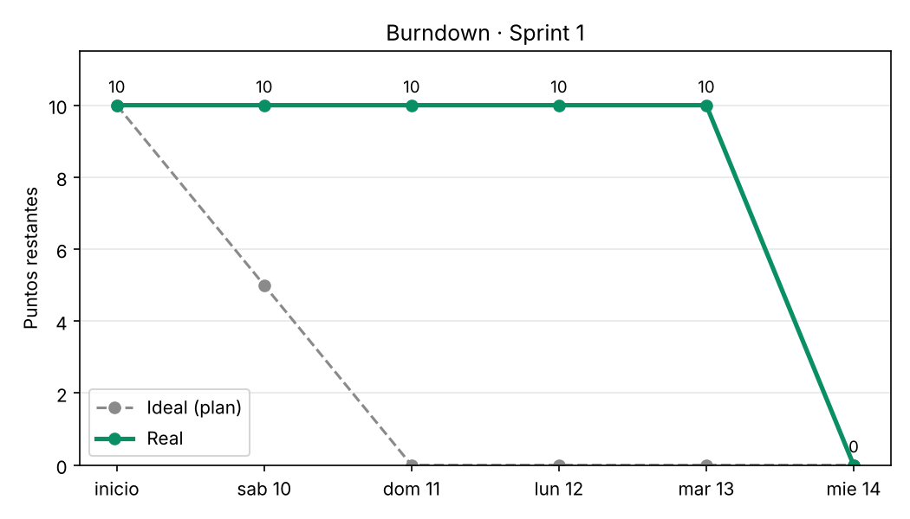
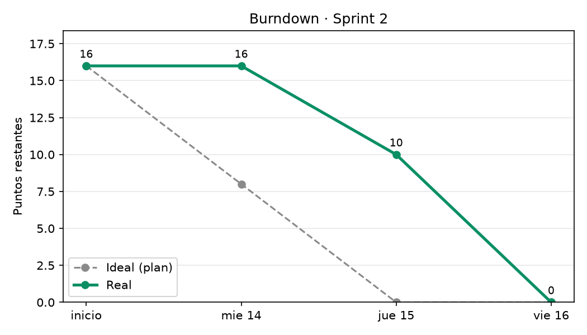

# Sprints – Backlog, Velocity y Burndown

Escala de puntos: Fibonacci (1, 2, 3, 5, 8); deben coincidir con los de Trello.
Velocity = puntos de las historias que cumplen la Definition of Done.
Responsable de Velocity y Burndown: Michelle.
Gráficos: `python docs/scrum/burndown.py` (lee `docs/scrum/burndown.csv` y guarda los PNG en `docs/evidencias/`).

## Definition of Done

- [x] Código en una rama `feature/...` trabajada en pareja (piloto/copiloto)
- [x] Tests automatizados escritos y en verde (`pytest`)
- [x] Pull Request revisado y aprobado por el integrante que no estuvo en la pareja
- [x] Merge a `main` y tarjeta movida a *Done* en Trello

---

## Sprint 1 – Calidad de datos (plan: sáb 10 – dom 11 oct · real: sáb 10 – mié 14 oct)

**Objetivo del Sprint:** que ningún dato inválido llegue a los modelos de mora y churn. **Cumplido.**

| # | Historia | Rama | Pareja (piloto + copiloto) | Revisor PR | PR | Merge | Puntos | Estado |
|---|---|---|---|---|---|---|---|---|
| 0 | Setup Corte 2 (estructura, pytest, plantillas) | `chore/setup-corte2` | Michelle | Daniel | #1 | 10 oct 15:49 | – | Done |
| 1 | Data Ingestion Pipeline (ya cerrada, solo documentación) | `docs/sprint1-data-ingestion` | Daniel | Michelle | #2 | 10 oct 21:53 | – | Done |
| 2 | Data Transformation and Cleaning (Delinquency) | `feature/sprint1-delinquency-validation` | Daniel + Maria | Michelle | #3 | 14 oct 11:59 | 5 | Done |
| 3 | Data Transformation and Cleaning (Churn) | `feature/sprint1-churn-validation` | Daniel + Maria | Michelle | #4 | 14 oct 14:18 | 5 | Done |

- Puntos comprometidos: **10**
- Puntos completados: **10**
- Velocity real: **10 puntos (100 % de lo comprometido)**, en 5 días calendario en lugar de los 2 planeados.
- Resultado técnico: 32 tests automatizados en verde; `train_models.py` bloquea datos inválidos; refactor documentado en `docs/xp/refactor_01_validation.md`.

### Burndown (puntos restantes al final de cada día)

| Día | Fecha | Ideal | Real | Qué pasó |
|---|---|---|---|---|
| 0 | inicio | 10 | 10 | Setup fusionado (PR #1) y Tarea 1 documentada (PR #2) el sáb 10 |
| 1 | sáb 10 | 5 | 10 | Tarea 2 iniciada, sin cerrar |
| 2 | dom 11 | 0 | 10 | Sin merges (fin del plan) |
| 3 | lun 12 | 0 | 10 | Sin merges |
| 4 | mar 13 | 0 | 10 | Reorganización del equipo: cada pareja trabaja desde su PC en llamada |
| 5 | mié 14 | 0 | 0 | Tarea 2 (PR #3, 11:59) y Tarea 3 (PR #4, 14:18) fusionadas |

**Lectura:** la línea real se quedó plana 4 días y cayó de golpe el último. El equipo completó todo lo
comprometido (Velocity 100 %) pero con 3 días de retraso, porque el trabajo se concentró en una sola
sesión en lugar de repartirse en el Sprint. Ver Retrospectiva 1.

---

## Sprint 2 – Modelos y dashboards (plan: mié 14 – jue 15 oct / real: mié 14 – vie 16 oct)

**Objetivo del Sprint:** que cada modelo tenga sus métricas guardadas y documentadas, y que cada
dashboard priorice clientes con reglas claras y probadas. **Cumplido**

Regla de revisión: Cuando Daniel es piloto lo revisa Michelle, cuando Michelle es piloto  lo revisa Maria y cuando Maria es piloto lo revisa Daniel.

| # | Historia | Rama | Pareja (piloto + copiloto) | Revisor PR | PR | Merge | Puntos | Estado |
|---|---|---|---|---|---|---|---|---|
| 4 | Predictive Model (Delinquency) | `feature/sprint2-delinquency-docs-validation` | Michelle + Daniel | Maria | #6 | 15 oct 21:10 | 3 | Done |
| 5 | Predictive Model (Churn) | `feature/sprint2-churn-docs-validation` | Michelle + Daniel | Maria | #7 | 15 oct 21:18 | 3 | Done |
| 6 | Delinquency Dashboard | `feature/sprint2-delinquency-dashboard` | Maria + Michelle | Daniel | #9 | 16 oct 05:36 | 5 | Done |
| 7 | Churn Dashboard | `feature/sprint2-churn-dashboard` | Maria + Michelle | Daniel | #10 | 16 oct 11:09 | 5 | Done |

- Puntos comprometidos: 16
- Puntos completados: 16
- Velocity real: 16 puntos (100 % de lo comprometido), en 3 días calendario en lugar de los 2 planeados.
- Resultado técnico: 57 tests automatizados en verde; ambos dashboards usan `dashboard_logic.py` con reglas de alerta, `priority_score` y alerta SHAP.

### Burndown (puntos restantes al final de cada día)

| Día | Fecha | Ideal | Real | Qué pasó |
|---|---|---|---|---|
| 0 | inicio | 16 | 16 | Inicio del Sprint 2 |
| 1 | mié 14 | 8 | 16 | Tareas 4 y 5 listas en rama, sin merge |
| 2 | jue 15 | 0 | 10 | PR #6 (21:10) y #7 (21:18) fusionados |
| 3 | vie 16 | 0 | 0 | PR #9 (05:36) y #10 (11:09) fusionados |

**Lectura:** la línea real se mantuvo en 16 el primer día, bajó a 10 al fusionar las Tareas 4 y 5 el jueves por la noche y llegó a 0 el viernes con las Tareas 6 y 7. Se completó todo lo comprometido (Velocity 100 %) pero con un día de retraso, porque la Tarea 7 dependía de la 6 y su PR se fusionó hasta el viernes. Ver Retrospectiva 2.